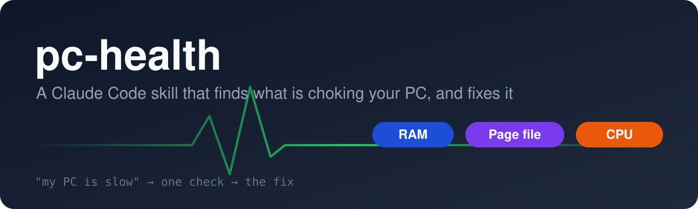
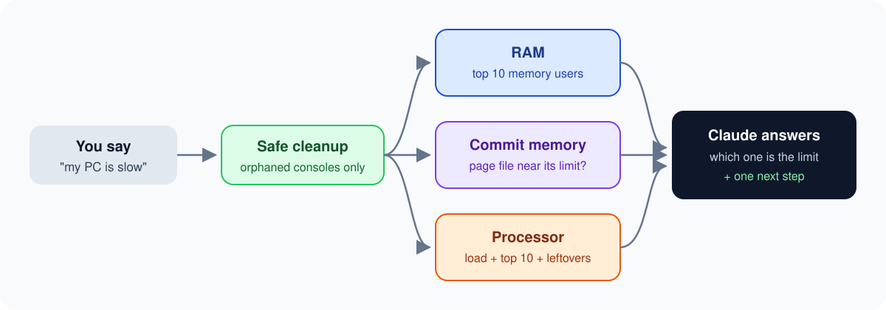
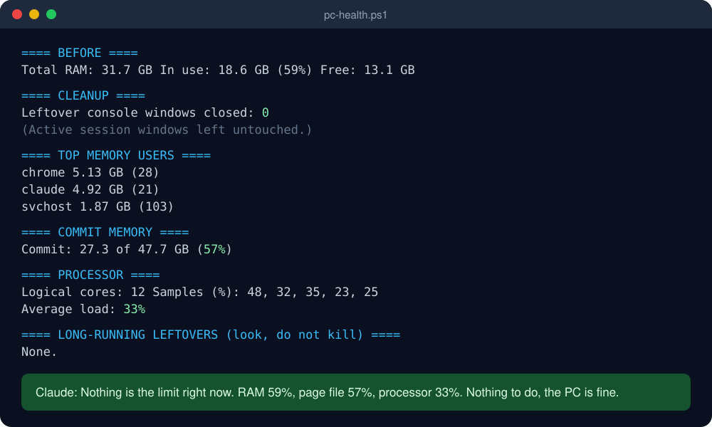

<p align="center">
  
</p>

<p align="center">
  <a href="LICENSE"></a>
  
  
  
</p>

# pc-health

Run three, five, ten Claude Code sessions on one Windows machine and sooner or later it chokes. The question is always the same: **what is full?**

There are three different answers, and each one has a different fix:

| What is full | What you see | The fix |
|---|---|---|
| **RAM** | Everything slows down | Close the apps that use the most memory |
| **Commit memory** (page file) | The PC freezes even with RAM free | A bigger, fixed page file, not closing apps |
| **Processor** | Fans spin, typing lags | Find the busy process: a session, a hook, Defender, a stray command |

`pc-health` finds which one is full and fixes it. It cleans up the safe leftovers by itself, and for everything else Claude gives you the exact fix in plain words.

## How it works

<p align="center">
  
</p>

1. You tell Claude Code "my PC is slow" (or "check the PC", "free memory", "CPU at 100%").
2. The skill runs `scripts/pc-health.ps1`.
3. The script closes orphaned console windows: empty `conhost.exe` processes whose program already exited. These pile up when terminal sessions are closed by the window's X button.
4. It reads RAM, commit memory and processor load, and lists the top users of each, plus any long-running leftover commands.
5. Claude answers in three sentences: which one is the limit, the numbers, and one next step.

## Sample run

<p align="center">
  
</p>

## Install

Copy the folder into your Claude Code skills folder:

```powershell
git clone https://github.com/gehtalexey/pc-health "$HOME\.claude\skills\pc-health"
```

Start a new Claude Code session. Say "my PC is slow" and the skill loads by itself.

You can also run the script on its own, without Claude:

```powershell
powershell -NoProfile -ExecutionPolicy Bypass -File "$HOME\.claude\skills\pc-health\scripts\pc-health.ps1"
```

## Is it safe?

Yes. The script changes one thing only:

- It force-closes `conhost.exe` processes **whose parent process is already gone**. A console that belongs to a live terminal or a running Claude Code session is never touched. The script also protects its own chain of parent processes.
- Everything else is read-only. Long-running leftovers are **listed, never stopped**.
- The skill tells Claude never to change system or security settings (page file, Windows Defender). When a fix needs one, Claude gives you the exact line to run yourself in an admin PowerShell.

Read the script before you run it: it is about 180 lines of plain PowerShell.

## What we learned running it

These came from real freezes on a machine running many Claude Code sessions at once:

- **A PC can freeze with 12 GB of RAM free.** Commit memory was full because Windows had picked a 2 GB page file. A fixed 16-32 GB page file fixed it.
- **The processor is usually the limit, not RAM**, on low-power "U" laptop chips.
- **Hooks add up.** A hook that takes 2 seconds runs on every tool call in every session. Removing one slow hook and merging five small ones into one process took a Bash call from 294 ms to 71 ms.
- **Local MCP servers multiply.** Each session starts its own copy of each stdio MCP server. One machine had 28 copies running; removing them dropped commit memory from 38.6 to 27.6 GB.

## Files

```
pc-health/
├── SKILL.md              instructions Claude reads
├── scripts/
│   └── pc-health.ps1     the check and the safe cleanup
├── assets/               pictures for this page
└── LICENSE               MIT
```

## Limits

- Windows only (PowerShell 5.1 or later).
- The "top processor users" list uses Windows performance counters with English names. On a Windows install in another language, that one section may come back empty; the rest still works.

## License

[MIT](LICENSE). Use it, change it, share it.

Built by [Alexey Geht](https://github.com/gehtalexey) at Added Value, with Claude Code.
